# Runtime architecture

This page defines the runtime module boundaries and the evidence required to
change them. An arrow in the diagram means “depends on”. The diagram is the
target module DAG. The architecture test and CI determine whether the source
conforms to it.

## Ownership and authority

| Area | Owner | Boundary |
| --- | --- | --- |
| Declaration | `declaration` | Parses and validates `.specgit.yaml`. It owns schema rules, not file access or Git lookup. |
| Repository identity | `identity` | Defines repository, host, and object-ID rules. It does not call Git or a forge. |
| Local project state | `config`, `project`, `selection` | Reads project configuration and Git context. State belongs to the repository or its Git metadata. `config::worktree` owns the read-only private-state probe and sibling-consumer discovery for worktree-shared assets. |
| Agent integration | `setup`, `guidance`, `prompts`, `assets` | Builds and writes project-scoped Skills, stable instruction entries, host context hooks, and ownership receipts. Setup includes a typed native guard plan in the same transaction. It does not install global host state or a project executable. |
| Native Git guard | `guard` | Checks checkpoints when installed pre-commit/pre-push hooks run; owns Git hook planning, independent/setup receipt proof and shared-consumer rechecks. Ordinary editor tools have no checkpoint gate. |
| User Skill | `skill` | Owns the shared embedded Skill bytes and the explicitly installed user Skill file. A SHA-256 marker establishes ownership; refresh backs up edited content, removal preserves edits. No global hooks, state, lock file or receipts. |
| Native platform | `forge_read`, `forge_routes`, `forge`, `native_delivery` | Separates read transport, route construction, response decoding, and explicit mutation. The forge owns CI, protection, review, and merge. |
| Observation | `observation_model`, `watch_store`, `watch`, `observation`, `report` | Stores scoped event facts and presents them. An observation is not authorization or proof of completion. |
| Self-update | `self_update` | Reads signed GitHub Releases through `gh`, verifies Cosign, the manifest row, the ZIP entry and its version, then replaces only the running executable with a backup. After successful install it probes user Skill ownership and invokes the new executable to refresh only an existing managed Skill. It does not touch project state; refresh failure does not roll back the binary. |
| Command line | `cli`, `main` | Parses and dispatches commands, then formats output. `main` is only the process entry point. |
| Delivery context | `delivery_context::Workspace` | Loads and rechecks Git, declaration, and native project identity. It does not own Issue or PR write transactions. |

The local runtime enforces checkpoints only at installed Git commit/push hooks.
Host SessionStart/PreToolUse hooks offer context and recovery guidance without
tool denial. Retired PostToolUse/Stop callbacks exit before input or state work.
Missing host context is diagnostic evidence, not a request for another turn.

Native writes require existing user authorization. A declaration and a
`--dry-run` result grant no permission. GitHub or GitLab decides whether CI,
review, protection, and merge conditions pass. SpecGit must read back native
state before it reports delivery completion.

## Module dependency DAG

The table records every runtime component, its layer, and all direct component
dependencies. Internal module edges and unit-test modules are excluded. The
architecture test parses every production source file, including platform code,
and requires this table to match that graph. Same-layer dependencies are allowed
only while the complete graph remains acyclic. A component may otherwise depend
only on a lower layer. Layer 0 contains pure rules and models.

<!-- runtime-components:start -->
| Component | Layer | Direct dependencies |
| --- | --- | --- |
| `assets` | 1 | `diagnostic`, `input` |
| `cli` | 10 | `assets`, `cli_contract`, `config`, `diagnostic`, `forge`, `guard`, `guidance`, `hook`, `init`, `issue`, `migrate`, `pr`, `probe`, `process`, `project`, `remove`, `report`, `selection`, `self_update`, `setup`, `skill`, `watch` |
| `cli_contract` | 1 | — |
| `config` | 2 | `assets`, `declaration`, `diagnostic`, `identity`, `input`, `process`, `project`, `project_receipt` |
| `declaration` | 0 | `diagnostic`, `identity`, `label_rules` |
| `delivery_context` | 7 | `config`, `diagnostic`, `probe`, `process`, `project`, `spec` |
| `delivery_model` | 0 | `diagnostic`, `identity` |
| `diagnostic` | 0 | — |
| `forge` | 5 | `declaration`, `delivery_model`, `diagnostic`, `forge_read`, `forge_routes`, `identity`, `input`, `native_checks`, `process`, `project`, `spec` |
| `forge_read` | 3 | `delivery_model`, `diagnostic`, `forge_routes`, `identity`, `input`, `process` |
| `forge_routes` | 0 | `identity` |
| `guard` | 8 | `assets`, `config`, `diagnostic`, `input`, `process`, `project`, `selection` |
| `guidance` | 2 | `assets`, `declaration`, `diagnostic`, `input`, `prompts` |
| `hook` | 9 | `assets`, `config`, `declaration`, `diagnostic`, `input`, `process`, `project`, `selection`, `watch`, `watch_store` |
| `i18n` | 0 | `declaration`, `diagnostic`, `report` |
| `identity` | 0 | `diagnostic` |
| `init` | 8 | `assets`, `config`, `delivery_model`, `diagnostic`, `forge`, `forge_read`, `guard`, `i18n`, `local_exclude`, `migration_assets`, `probe`, `process`, `project`, `report`, `setup`, `templates` |
| `input` | 0 | `diagnostic` |
| `issue` | 8 | `assets`, `config`, `delivery_context`, `delivery_model`, `diagnostic`, `identity`, `native_delivery`, `process`, `project`, `report`, `selection`, `spec`, `templates` |
| `label_rules` | 0 | — |
| `local_exclude` | 2 | `assets`, `diagnostic`, `process`, `project` |
| `migrate` | 8 | `assets`, `config`, `diagnostic`, `guidance`, `local_exclude`, `migration_assets`, `migration_remote`, `probe`, `process`, `project`, `report`, `templates` |
| `migration_assets` | 2 | `assets`, `config`, `diagnostic`, `input` |
| `migration_remote` | 6 | `config`, `diagnostic`, `native_delivery`, `native_file`, `probe`, `project` |
| `native_checks` | 4 | `delivery_model`, `diagnostic`, `forge_read`, `forge_routes`, `identity` |
| `native_delivery` | 6 | `declaration`, `delivery_model`, `diagnostic`, `forge`, `forge_read`, `forge_routes`, `identity`, `process` |
| `native_file` | 4 | `declaration`, `diagnostic`, `forge_read`, `forge_routes`, `identity` |
| `observation` | 8 | `assets`, `delivery_context`, `delivery_model`, `diagnostic`, `forge`, `native_delivery`, `observation_model`, `process`, `project`, `selection`, `spec` |
| `observation_model` | 0 | `delivery_model`, `diagnostic`, `identity` |
| `pr` | 8 | `delivery_context`, `delivery_model`, `diagnostic`, `identity`, `init`, `native_delivery`, `observation`, `process`, `project`, `report`, `selection`, `spec`, `templates` |
| `probe` | 4 | `assets`, `delivery_model`, `diagnostic`, `forge_read`, `identity`, `process`, `project` |
| `process` | 1 | `diagnostic` |
| `project` | 2 | `diagnostic`, `identity`, `process` |
| `project_receipt` | 0 | `diagnostic`, `input` |
| `prompts` | 0 | `declaration` |
| `remove` | 9 | `assets`, `config`, `delivery_context`, `diagnostic`, `guard`, `guidance`, `local_exclude`, `observation`, `process`, `project`, `report`, `selection`, `setup` |
| `report` | 0 | `diagnostic`, `observation_model` |
| `selection` | 2 | `assets`, `declaration`, `delivery_model`, `diagnostic`, `identity`, `input`, `project` |
| `self_update` | 2 | `diagnostic`, `process`, `report`, `skill` |
| `setup` | 8 | `assets`, `config`, `diagnostic`, `guard`, `guidance`, `input`, `local_exclude`, `process`, `project`, `project_receipt`, `prompts`, `report`, `skill` |
| `skill` | 2 | `assets`, `diagnostic`, `report` |
| `spec` | 0 | `declaration`, `diagnostic`, `identity`, `label_rules`, `template_rules` |
| `template_rules` | 0 | `declaration` |
| `templates` | 2 | `assets`, `declaration`, `diagnostic`, `label_rules`, `template_rules` |
| `watch` | 8 | `assets`, `config`, `delivery_model`, `diagnostic`, `observation`, `process`, `project`, `report`, `watch_store` |
| `watch_store` | 2 | `assets`, `declaration`, `delivery_model`, `diagnostic`, `identity`, `input`, `observation_model`, `project` |
<!-- runtime-components:end -->

The diagram shows selected edges from the table. Every arrow means “depends on”
and is checked against the same source graph. `main` only starts `cli`.

```mermaid
flowchart TD
  cli --> init
  cli --> setup
  cli --> issue
  cli --> pr
  cli --> probe
  cli --> watch
  cli --> self_update
  cli --> skill
  cli --> assets
  cli --> guidance
  cli --> guard
  cli --> config
  cli --> migrate
  cli --> remove
  cli --> hook
  cli --> forge
  cli --> process
  cli --> selection
  cli --> report
  cli --> cli_contract
  cli --> project
  self_update --> process
  self_update --> report
  self_update --> skill
  skill --> assets
  skill --> report
  setup --> skill
  setup --> config

  issue --> delivery_context
  pr --> delivery_context
  issue --> spec
  pr --> spec
  issue --> native_delivery
  pr --> native_delivery
  pr --> init
  pr --> observation
  delivery_context --> config
  delivery_context --> project
  delivery_context --> probe

  init --> setup
  init --> guard
  init --> config
  setup --> prompts
  setup --> guidance
  setup --> local_exclude
  setup --> assets
  setup --> guard
  setup --> project_receipt
  config --> project_receipt
  guard --> config
  guard --> project
  guard --> selection
  guard --> assets
  hook --> config
  hook --> project
  hook --> selection
  hook --> watch_store
  hook --> watch
  guidance --> prompts
  config --> declaration
  config --> identity
  config --> project
  project --> identity
  spec --> declaration
  templates --> declaration
  templates --> template_rules
  declaration --> label_rules

  probe --> forge_read
  watch --> observation
  watch --> watch_store
  observation --> delivery_context
  observation --> forge
  observation --> native_delivery
  observation --> observation_model
  watch_store --> observation_model
  report --> observation_model

  forge_read --> forge_routes
  forge_read --> identity
  forge_read --> process
  forge_read --> input
  forge_read --> delivery_model
  forge --> forge_read
  forge --> identity
  forge --> delivery_model
  forge --> project
  forge --> native_checks
  native_delivery --> forge
  native_delivery --> forge_read
  migration_remote --> native_file
  migrate --> migration_remote
  migrate --> migration_assets
  remove --> setup
  templates --> assets

  subgraph pure[Pure rules and models]
    diagnostic
    input
    forge_routes
    prompts
    report
    i18n
    project_receipt
    declaration
    identity
    label_rules
    template_rules
    spec
    delivery_model
    observation_model
  end
```



The intended boundaries are:

- `declaration` owns schema and validation rules. `identity` owns repository,
  host, and object-ID rules. `label_rules` and `template_rules` own vocabulary.
- `project_receipt` owns the pure, complete project receipt decoder and selected-agent/purpose invariants. Setup, guard and shared rollback use this one contract; file reads and root-path resolution stay in adapters.
- `config` is the local read and routing facade. It may keep compatibility
  aliases. Pure rules stay in their owner modules.
- `project` owns Git process interaction. Its identity re-exports preserve
  existing callers; they must not copy the identity implementation.
- `forge_read` is read-only. It exposes `get` for resource reads and fixed
  GraphQL operations for complete closing references. It does not expose
  mutation methods.
- `forge_routes` builds API paths. `forge` decodes platform responses.
  `probe` measures supported capabilities. `native_delivery` owns explicit
  native writes.
- `issue` and `pr` keep their preparation, review, and write steps private.
  Their `Workspace` loads and rechecks project identity. Each write flow owns
  its transaction, journal, and locking behavior.
- `observation_model` contains fact classification. `watch_store` and
  `report` depend on that model, not on the `observation` use case.
- `skill` owns the embedded Skill source shared with `setup`, and manages only
  the explicitly selected user Skill file. It depends on `assets`, `diagnostic`
  and `report`; no project or host state is loaded.
- `self_update` depends only on `process`, `diagnostic`, `report` and `skill`. It owns
  release selection, verification and executable replacement. Tests may
  redirect the install target only in `test-fixtures` builds.
  Its post-install Skill child uses the new executable, bounded argv transport
  and the child's report; it never performs the refresh with old embedded bytes.
- `cli` separates argument parsing, host behavior, dispatch, inspection, and
  output. `main` only starts the CLI.
- Doctor's health inspection uses typed setup/guidance/guard asset plans and
  applies them through their owning modules. The CLI does not parse its own JSON
  report or invoke host hooks; offline checks do not launch platform probes.
- `prompts` embeds one stable host entry; the language-specific compatibility
  function delegates to that same source. `runtime/assets/SKILL.md` remains the
  full operational guide, installed as an ignored project Skill. Tracked entries
  contain no runtime version, declaration summary or dynamic content hash.
- `init` uses setup's typed project asset plan to initialize the generic Skill and
  entry without adding hooks. Setup owns the single project receipt for these
  assets. `guidance` validates legacy init blocks and retains the initialization
  marker; migration does not grant ordinary removal permission to discard edits.
- `guard` discovers Git hook paths through `project` and returns a typed plan.
  Setup/init/doctor apply that plan atomically with their other assets; they do
  not parse guard JSON or perform a second independent installation. Guard
  ownership and shared-consumer preconditions are checked again under a common
  Git-directory lock before writes.
- `hook` offers bounded local context for SessionStart/PreToolUse. It reads
  pending notice IDs without fetching forge data or acknowledging them. Its
  session/event offer ledger suppresses repeated text, not future Agent work.

These edges describe the intended design. Do not treat this page alone as
evidence that an unfinished extraction or test has passed.

## Assets, rollback, and notices

Project integration remains project-only. The only user-level asset is the
explicitly installed Skill file; no global hooks, state or receipts. Its marker
and sibling edited-content backups are separate from project receipts. It locks
the existing Skill itself, rechecks ownership/content, and publishes synced
same-directory temporary files atomically. Absent-file publication cannot clobber
a concurrent creation. User Skill removal never removes edited files or backups.

Setup owns only the project files and hook entries recorded in its private
Git-metadata receipt at `agent-assets/ownership.json`. Init and setup apply their
plans through the same `assets` transaction store and lock. Legacy `agent-assets`
journals remain bounded migration/recovery evidence; their receipt-generation and
permission checks still apply. The empty legacy initialization receipt records
initialization without owning a second entry. The v4 project receipt stores
purposes explicitly, avoiding ambiguity between old guard and new context hooks.
Independent Git guards retain `guard-hooks.json`; setup-owned guard blocks use
`setup-guard-hooks.json` and share the project asset transaction. Reuse never silently adopts an independent
guard; explicit independent installation can transfer setup-owned blocks with
their original preimages. Active setup and sibling consumers retain shared
blocks until the last applicable consumer releases them. New standalone guard
transactions also use the shared `assets` store; legacy guard journals remain
bounded read-only recovery evidence.

Partial rollback retains the original journal and records its exact remaining
entries. Only retained entries remain ownership evidence. A later rollback
rechecks consumers, content and permissions and cannot replay already restored
entries. Host context offers use a bounded atomic checkpoint without transaction
journals; advisory deduplication must not grow durable history per notification.

Refresh and uninstall must validate the recorded content before changing it.
An edited or ambiguous owned asset is preserved for reconciliation. Foreign
instruction text, hook entries, and shell-hook content must remain intact.
Rollback restores a recorded transaction in its original Git metadata scope.
It must not widen asset ownership or move state to a global directory.
Linked worktrees share `info/exclude` and the common hooks directory while
receipts stay per worktree. Removal, init/migrate rollback and guard uninstall
use the same `config::worktree` consumer check and keep shared blocks that a
sibling with a declaration or initialized private state still relies on.

Observation notices describe evidence at a recorded time. A notice is not a
fresh read. Refresh native evidence before acting on it. Acknowledging an exact
event ID records receipt; it does not prove that a person read the notice or
that delivery is complete. Only native readback of the intended merge and all
selected Issue closures establishes completion.

## Maintenance and checks

When a module boundary changes, update this DAG and the architecture contract
in the same change. Keep compatibility APIs as aliases or re-exports when
possible. Do not duplicate rule implementations across modules.

The architecture contract is finite. It requires an acyclic full-source
dependency graph, zero layer violations, read-only forge access limited to
`GET` and fixed closing-reference GraphQL operations, and passing public API
compatibility checks. Release qualification must also pass on Linux x64,
macOS arm64, and Windows x64. These checks do not claim that all technical debt
is absent.

For documentation-only edits, review this page and run:

```sh
node scripts/ci-metadata-check.mjs
```

For module or runtime changes, use the pinned Rust checks and the applicable
native CI matrix in [CI scope](ci-scope.md). A diagram or a local compile does
not replace the complete-source architecture test or three-platform CI.

Native rollback acquires the shared native guard serialization lock before any asset-store lock. `config::worktree::lock_native_guard` returns the token required by `rollback_with_lock`; both locks remain held while consumers and transaction targets are rechecked. The old prelocked-store `rollback` signature returns an explicit migration diagnostic without writes because it cannot safely establish that order.
